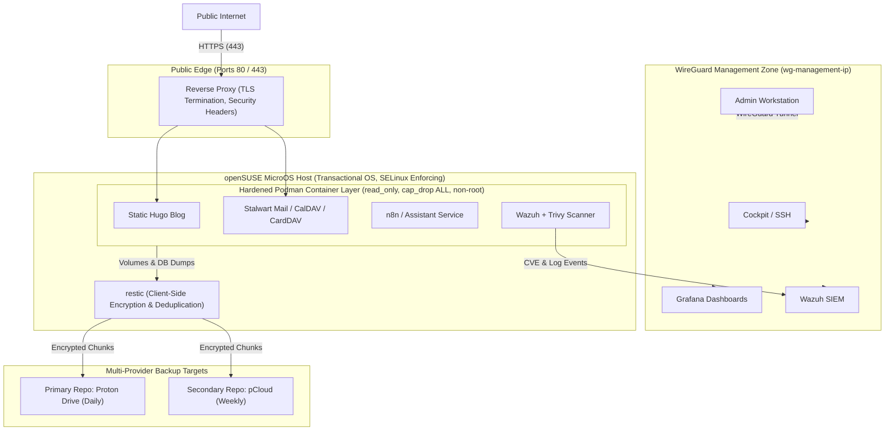

# Hardened Single-Host Reference Architecture

A hardened, reproducible reference architecture demonstrating the principles described in the companion article: *Zero-Access Confidential Layer* ([Companion Article](#)).

This repository documents a production-operated Linux server architecture built on openSUSE MicroOS, rootless/hardened Podman containers, WireGuard network segmentation, Wazuh/Trivy continuous vulnerability monitoring, and client-side encrypted multi-provider backups via `restic`.

> **Important Scope Notice:** This is a single-host reference implementation. It is **not** a substitute for hardware-enforced Confidential Computing infrastructure. Trusted Execution Environments (TEEs such as AMD SEV-SNP or Intel TDX) are intentionally **not** simulated. Instead, this repository demonstrates how the software-architecture principles of isolation, client-side key control, verifiability, and multi-provider resilience can be applied on standard VPS hardware.

## Table of Contents

- [Architecture Overview](#architecture-overview)
- [What This Demonstrates](#what-this-demonstrates)
- [Repository Structure](#repository-structure)
- [Quick Start](#quick-start)

## Architecture Overview

## What This Demonstrates

| Article Pillar | Reference Implementation | Security & Architecture Rationale |
| :--- | :--- | :--- |
| **Isolation** | Podman containers with `read_only`, `cap_drop: [ALL]`, `no-new-privileges`, `tmpfs` (`noexec,nosuid`), non-root UIDs, and SELinux enforcing | Limits blast radius if a service is compromised; prevents persistent filesystem modification and privilege escalation within the container boundary. |
| **Key Management** | Client-side encryption and deduplication via `restic` before data leaves the host | Storage providers (Proton Drive, pCloud) only ever receive encrypted, content-addressed chunks; repository keys remain under operator control. |
| **Verifiability** | Automated `trivy` container image/runtime scans integrated into `wazuh` and visualized in `grafana` | Provides continuous, auditable visibility into CVEs across custom-built and upstream containers rather than relying on implicit trust. |
| **Multi-Provider Resilience** | `restic` multi-target strategy (daily primary on Proton Drive, weekly secondary on pCloud) with daily `restic check` | Eliminates single-provider lock-in and detects silent bit-rot or repository corruption early through scheduled integrity verification. |

## Repository Structure

- [`docs/architecture.md`](docs/architecture.md) — Detailed component breakdown and design rationales (German)
- [`docs/hardening-checklist.md`](docs/hardening-checklist.md) — OS, container, and network hardening checklist (German)
- [`docs/backup-strategy.md`](docs/backup-strategy.md) — `restic` topology, integrity checks, and restore procedures (German)
- [`docs/replicate.md`](docs/replicate.md) — Step-by-step replication guide for a fresh VPS (English)
- [`examples/hugo-blog/`](examples/hugo-blog/) — Minimal, hardened multi-stage container definition for a static Hugo site

## Quick Start

To replicate this architecture on your own VPS, follow the step-by-step instructions in [`docs/replicate.md`](docs/replicate.md).
